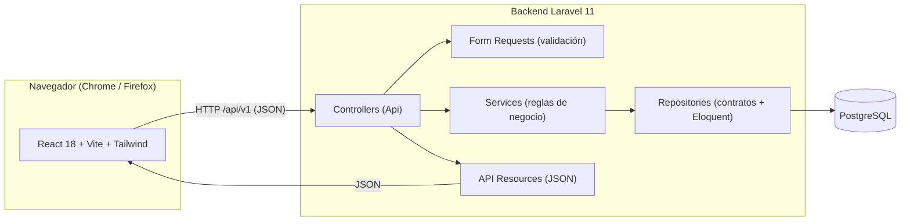
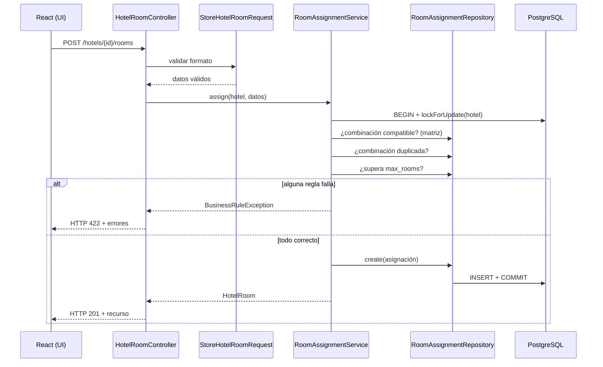

# Arquitectura

## Visión general

El sistema está compuesto por dos aplicaciones **desacopladas** que se comunican
exclusivamente por una API RESTful en formato JSON.

## Patrón Service–Repository (backend)

La lógica se separa en capas con responsabilidades claras (SOLID):

- **Controller:** recibe la petición HTTP y delega. No contiene lógica de negocio.
- **Form Request:** valida el formato de entrada (tipos, campos obligatorios,
  unicidad simple).
- **Service:** contiene las reglas de negocio del dominio. `RoomAssignmentService`
  concentra las cuatro reglas de asignación de habitaciones.
- **Repository:** abstrae el acceso a datos tras una interfaz. El `Service`
  depende de la **interfaz**, no de Eloquent (Inversión de Dependencias). Cambiar
  de ORM solo requeriría una nueva implementación del contrato.
- **Resource:** transforma los modelos en la respuesta JSON pública.

## Flujo de una asignación de habitaciones

## Decisiones clave

- **Validación en dos niveles:** el `Form Request` cubre el formato; el `Service`
  cubre las reglas de negocio que necesitan contexto (estado del hotel, matriz).
- **Transacción con bloqueo:** la verificación de `max_rooms` y la inserción
  ocurren dentro de una transacción con `lockForUpdate` para evitar que dos
  peticiones simultáneas excedan el límite.
- **Respuestas JSON garantizadas:** cualquier error bajo `/api/*` se renderiza
  como JSON, nunca como HTML, para mantener la API predecible.
