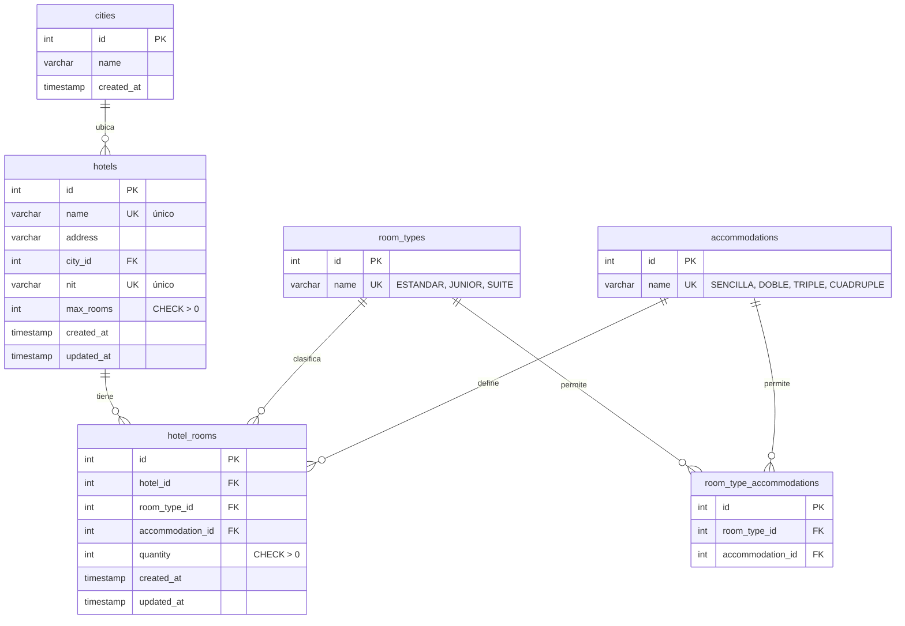

# Modelo Entidad-Relación

Diagrama de la base de datos del Sistema de Gestión Hotelera Decameron.

## Notas de diseño

- **`room_type_accommodations`** es la matriz de compatibilidad. Modelar las
  reglas como datos (y no como código) permite cambiarlas sin tocar la lógica
  (principio Open/Closed).
- **`hotels.name`** y **`hotels.nit`** tienen índice único: no hay hoteles
  repetidos.
- **`hotel_rooms`** tiene un índice único compuesto
  `(hotel_id, room_type_id, accommodation_id)`: no se repite una combinación
  en el mismo hotel.
- Los `CHECK (quantity > 0)` y `CHECK (max_rooms > 0)` protegen la integridad
  a nivel de base de datos.
- La regla "la suma de habitaciones no supera `max_rooms`" se valida en la capa
  de servicio (`RoomAssignmentService`) porque es un cálculo agregado por hotel,
  dentro de una transacción con bloqueo de fila para evitar condiciones de
  carrera.
